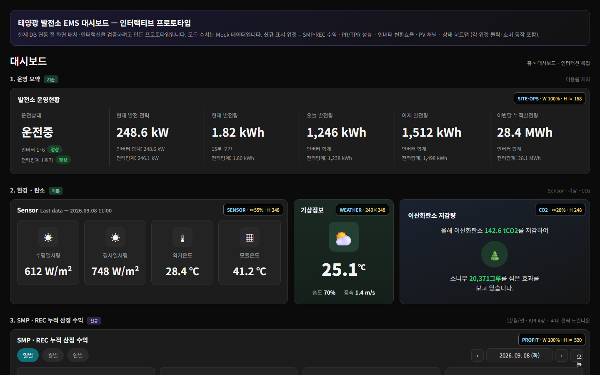
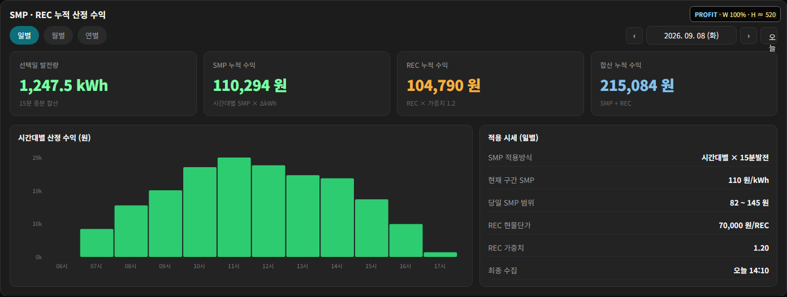
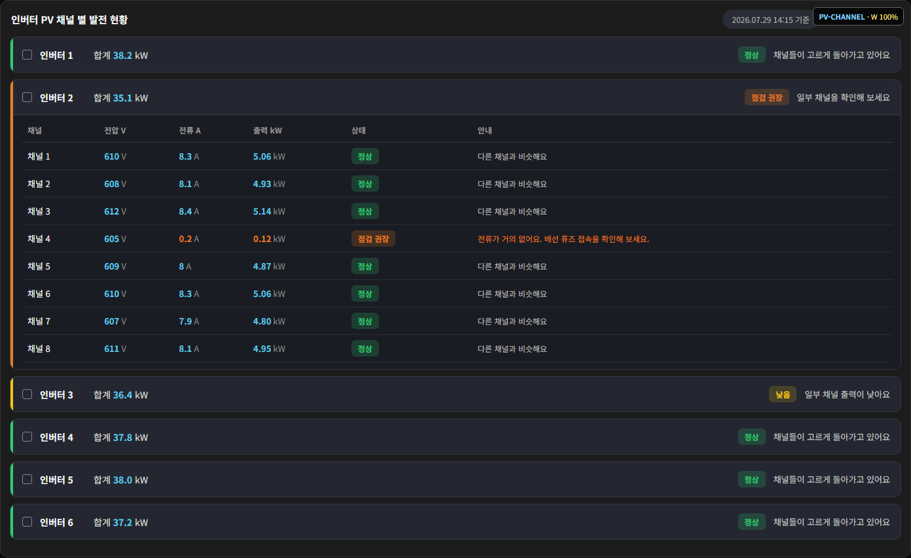
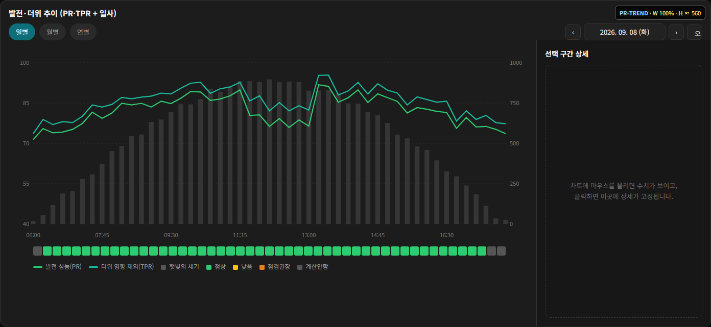
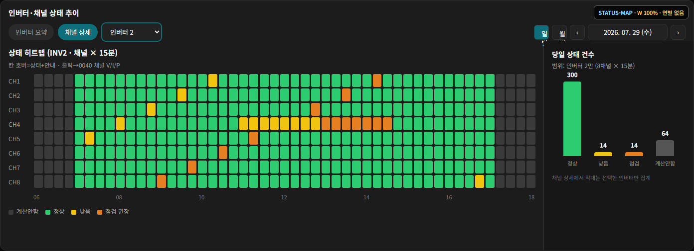

# Solar Plant EMS Dashboard Prototype

태양광 발전소용 EMS 대시보드의 **위젯 배치 · 인터랙션 프로토타입**입니다.
자가소비형 현장이 전력판매형으로 바뀌면서 필요해진 수익 · 성능 · 채널 진단 위젯을 설계하고, 개발 착수 전에 화면 흐름을 맞추려고 직접 만들었습니다.
빌드 도구 없이 HTML 파일 하나(순수 HTML · CSS · SVG · JavaScript)로 동작합니다.

> 모든 수치는 시연용 Mock 데이터입니다. 실제 현장 · 고객 정보는 포함하지 않습니다.

**라이브 데모:** https://bob-joosayo.github.io/solar-dashboard-layout/



## 배경과 역할

| 항목 | 내용 |
|---|---|
| 문제 | 기존 태양광 화면은 자가소비 기준(발전량 위주)이라, 전력을 파는 현장에서 필요한 **수익 · 성능 저하 원인** 을 보여 주지 못함 |
| 한 일 | 위젯 설계서 작성 → 이 프로토타입으로 배치 · 클릭 동작 검증 → 개발 전달 |
| 기준 | 15분 수집 주기, 일 · 월 · 연 집계, 고객이 읽는 문구(“이 값은 무엇인가요?”) 까지 화면 안에서 확정 |

## 위젯 구성

| # | 위젯 | 내용 |
|---|---|---|
| 1 | 발전소 운영현황 | 운전 상태, 현재 출력, 15분 · 오늘 · 어제 · 이번 달 발전량 (인버터 합계 vs 전력량계) |
| 2 | 환경 · 탄소 | 수평/경사 일사량, 외기 · 모듈 온도, 기상, CO₂ 저감량 |
| 3 | **SMP · REC 누적 산정 수익** | 시간대별 SMP × 15분 발전량 + REC × 가중치. 일/월/연 전환, 막대 클릭 시 상세 |
| 4 | **성능 현황 (PR / TPR)** | 경사일사 기준 성능비와 온도 보정 성능비, 정상 · 낮음 · 점검 권장 판정과 고객 안내 문구 |
| 5 | **인버터 변환효율** | 인버터별 DC → AC 변환효율 현황과 추이 (일사 막대 겹침) |
| 6 | 발전량 Trend | 인버터별 15분 · 누적, 이번 달 vs 지난달, 올해 vs 작년 |
| 7 | **PV 채널 현황** | 인버터 → 채널(스트링) 아코디언. 전압 · 전류 · 출력과 이상 채널 안내 |
| 8 | **상태 히트맵** | 15분 × 채널 상태(정상 · 낮음 · 점검 권장 · 계산안함) 히트맵과 건수 집계 |

굵게 표시한 위젯이 이번에 새로 설계한 위젯입니다. 각 위젯 오른쪽 위 태그(예: `PROFIT · W 100% · H ≈ 520`)는 개발 전달용 배치 크기입니다.

| SMP · REC 수익 | PV 채널 현황 |
|---|---|
|  |  |

| 성능 추이 (PR · TPR + 일사) | 상태 히트맵 |
|---|---|
|  |  |

## 설계 포인트

- **수익은 시세 × 발전량을 15분 단위로 누적**: SMP는 시간대별 단가를 15분 발전량에 곱하고, REC는 발전소별 가중치를 곱해 합산합니다. 시세 수집이 늦으면 직전 시세로 표시하고 마감 후 다시 계산하는 흐름을 전제로 했습니다.
- **성능 지표는 원인별로 분리**: 날씨 영향(PR) · 더위 영향 제외(TPR) · 인버터 변환 손실 · 채널(스트링) 불량을 각각 다른 위젯으로 나눠, “발전량이 왜 적은지”를 단계적으로 좁혀 가게 했습니다.
- **판정 문구까지 화면에서 확정**: 숫자만 보여 주지 않고 “일부 채널을 확인해 보세요” 같은 고객용 문구와 판정 색을 함께 설계했습니다.
- **일 → 월 → 연 드릴다운**: 추이 차트는 월 · 연에서 점을 클릭하면 해당 일로 내려가고, 호버 값과 클릭 고정 패널을 분리했습니다.

## 실행

빌드가 필요 없습니다. `index.html` 을 브라우저로 바로 열면 됩니다.

```bash
python -m http.server 8000
# http://localhost:8000/
```

## 관련 저장소

- [solar-report-html](https://github.com/BOB-joosayo/solar-report-html) — 같은 발전소의 일 · 월 · 연 A4 분석 리포트 화면
- [fuelcell-orc-dashboard](https://github.com/BOB-joosayo/fuelcell-orc-dashboard) — 연료전지 폐열 ORC 발전 실시간 모니터링 화면
